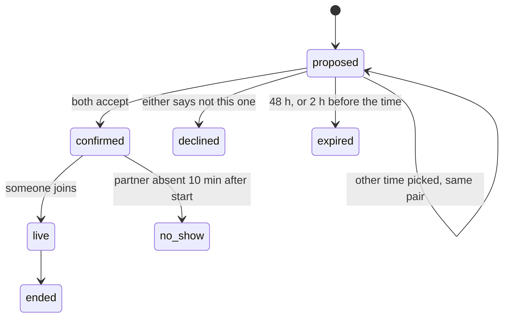

# Matching and asynchronous coffee chats

Connvo introduces two people for a 30-minute video conversation. The live queue (`/app/match-queue`) only works
when both people happen to be online at the same moment, which rarely happens with few users. This plan makes
the main path asynchronous: people say what they want and when they're free, Connvo proposes one good
introduction at a time, and both accept a time. The live queue stays as a secondary "Talk now" mode.

Read the engineering budget in `AGENTS.md` before building any part of this.

## What a person experiences

1. **Onboarding adds three things** to the existing profile and interests:
   - **What you want from conversations.** Pick up to three: find a mentor, mentor someone, meet peers in my
     field, explore a new field, find collaborators or a cofounder, hiring, looking for a job.
   - **When you're free.** Tap 30-minute blocks on a one-week grid in your own timezone, which is detected and
     editable. Presets such as "weekday lunches" or "weekday evenings" fill it in one tap.
   - **How often.** One or two chats a week, or paused.
2. **Twice a week** (Monday and Thursday, 08:00 in each person's timezone) Connvo proposes at most one
   introduction to each person who has room in their week.
3. **The proposal card**, on the home screen and by email, shows:
   - the other person: photo or initials, name, title and company;
   - two or three specific reasons, such as "You both work on developer tools" or "She has mentored first-time
     founders, and you asked for a founder mentor";
   - a suggested first question;
   - a proposed time in your timezone, the earliest time you're both free.

   The person can then:
   - **Accept.**
   - **Pick another time.** This shows up to three other times you share.
   - **Not this one.** An optional reason: not relevant, bad timing, or we've already met.
4. **When both accept**, the meeting exists. Both get a calendar invite with the join link, and email reminders
   24 hours and 10 minutes before. The home screen shows a countdown. A proposal expires after 48 hours, or 2 hours
   before the proposed time, whichever comes first.
5. **Joining.** The link opens the lobby 5 minutes before the start. The call is the existing call, with prompts
   and notes.
6. **No-shows.** If the other person hasn't joined 10 minutes after the start, you can end the meeting with "They
   didn't show". They get a strike, and you get priority in the next run. Two strikes in 30 days pause their
   matching until they confirm their availability again.
7. **After the call**, two taps:
   - "Would you talk again?" (yes or no), with optional reason chips;
   - "Connect". When both people connect, each appears in the other's network.

   These answers are the training signal for matching.
8. **Talk now.** The live queue remains for whoever is online and wants a conversation immediately.

## How matching works

One run builds proposals for everyone eligible at once, so it can make good pairs for the whole group rather
than first come, first served.

1. **Who's eligible.** People with room left in this week's cadence, at least one free block in the next 7 days,
   and matching not paused.
2. **Pairs that are never allowed:**
   - they share no language;
   - they have no free time in common at least 18 hours from now;
   - either one blocked or reported the other;
   - they met in the last 90 days, unless both said they'd talk again;
   - they work at the same company, if either person turned that setting on.
3. **A fast deterministic score**, extending `convex/matching/scoring.ts`. The weights live in one file and are
   starting guesses, not tuned values:
   - **Shared interests, weighted by rarity.** Sharing "Rust" or "bouldering" counts for more than sharing
     "technology". The weight is inverse document frequency over all profiles, after normalizing tags and
     synonyms. LinkedUp's normalizer is the starting point.
   - **Goal fit**, from a small explicit table. Mentor and mentee is the strongest. Collaborator and collaborator,
     and hiring and job-seeking, are strong. Peers in the same field come next, then someone exploring a field
     paired with someone who works in it. Anything else is weak.
   - **Experience.** For mentorship, the mentor should have roughly 3 to 10 more years; peers should be close.
   - **Field and role** closeness.
4. **Shortlist.** Each person's 8 best candidates by that score.
5. **The Decisions API reranks the shortlist.** This is the only place matching spends money.
   - **Request:** one per person, with a `choice` question whose options are their up to 8 candidates. It asks:
     "Which of these people would make the most valuable 30-minute conversation for this person, given what they
     want?" Inputs are short profile summaries: goals, role, field and interests, with no email or contact
     details.
   - **Score:** the answer's probabilities are the semantic score. A pair scored from both sides uses the average
     of the two directions. The pair's score is half the deterministic score and half the Decisions probability.
   - **Caching:** answers are cached for 7 days, keyed by the person and their candidate set.
   - **Fallback:** without a key, or after an error, refusal or timeout, matching uses the deterministic score
     alone.
   - **Cost:** about 600 input tokens per person per run, at the published $0.10 per million input tokens.
6. **Assignment.** Add a bonus for every run a person has waited without a match (capped), sort all candidate
   pairs by score, and take pairs greedily, skipping anyone already taken. Greedy is simple and close to optimal on
   a shortlist graph this sparse. If the stranded rate becomes a problem, switch to maximum-weight matching
   (Edmonds' blossom) without changing anything else.
7. **The time.** The earliest shared free block at least 18 hours away is proposed. The next three shared blocks
   are the alternatives.
8. **Reasons and first question.** The reasons come from the features that contributed most, named specifically:
   the rarest shared interests by name, the goal pair as a sentence, and the field. The first question comes from
   a written bank keyed by shared interest and goal. The Decisions API picks the best of four, or a deterministic
   pick when it's unavailable. No model writes text.
9. **Learning, later.** Every proposal stores its features and outcome: accepted, attended, would talk again, and
   connected. Weights stay as written until there are at least 200 outcomes. After that, fit them to the outcomes
   in one reviewed change, never automatically.

## Measuring match quality

This is the one evaluation that spends real API credits. It runs once the matcher works, before matching opens
to users.

- Write about 40 realistic profiles by hand, or use real users who agreed to it.
- Generate about 60 proposed pairs from three methods: deterministic only, deterministic plus Decisions, and
  random pairs that only satisfy the hard rules.
- Sam, or two raters, judge each pair blind: "Would this be a good 30-minute conversation?"
- Report each method's share of yes. The budget is under $1.

After launch, the acceptance rate, attendance and "would talk again" rate per method are the real measures.

## Tests worth writing

Only these. Each guards a bug that is plausible and would hurt someone:

- **One run never** puts a person in two proposals, pairs people the rules forbid, or proposes a time outside
  either person's free blocks.
- **Time math** across a daylight-saving change, and for two people whose free blocks fall on different calendar
  dates.
- **Proposal races.**
  - Both accept at the same moment: exactly one meeting.
  - One accepts while the other declines: no meeting.
  - Accepting after expiry is refused.
- **The Decisions adapter**: a refusal, an error, a timeout, or an answer naming a candidate that wasn't offered
  each falls back to the deterministic score.
- **The no-show strike window.**

Don't test rendering, styling, copy, the weight values, or anything the types already guarantee.

## Build order

Each step is a slice a person can see working:

1. Onboarding and settings collect goals, timezone, free time and cadence; block and report exist.
2. The twice-weekly matcher writes proposals: scoring, the Decisions rerank, assignment, reasons and the time.
3. The proposal card on home, accept, other time and decline, plus email when a proposal arrives. This needs an
   email provider; Resend is the default suggestion.
4. Scheduled meetings: the join window, reminders, no-shows and the countdown on home.
5. After the call: "would talk again" and "Connect". A real network page replaces the mock dashboard.
6. A design pass across the app shell, home, onboarding, the proposal card and the network page.
